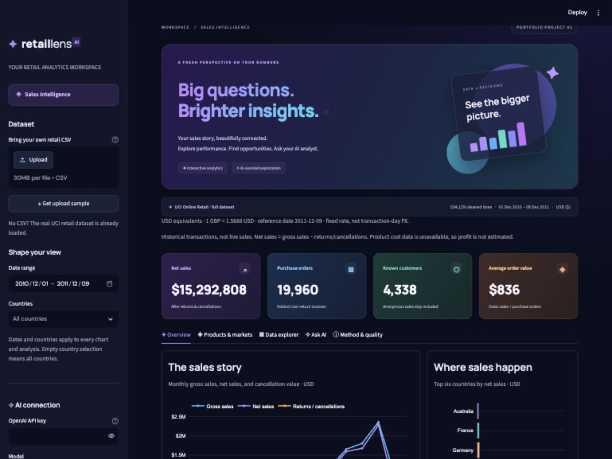

# ✦ Retail Lens AI

**A dark, vivid, interactive retail sales dashboard with an optional AI analyst.**

Python · Streamlit · Pandas · Plotly · SQL · Groq / Gemini / OpenAI

**[Open the Live Dashboard](https://retail-lens-ai-rmudadla629.streamlit.app/)** · [Read the case study](docs/case-study.md)

Deployed on Streamlit Community Cloud. Explore the charts and filters, then open **Ask AI** to try an analysis. AI availability depends on provider quotas; guided mode is also available.



One standalone project, built around a real business question: **where are sales coming from, which products lead, and how much value is lost to cancellations?**

## What you can do

- Explore net sales, purchase orders, known customers, and average order value.
- Filter all views by date range and country.
- Hover, zoom, and export interactive sales and market charts.
- Rank merchandise by net/gross sales, cancellations, or distinct orders.
- Upload a compatible CSV, review cleaning decisions, and export filtered records.
- Ask an AI analyst a question and inspect its analysis plan, formulas, and computed evidence.
- Use guided calculation mode without an API key; this mode is explicitly not AI.

The visual theme uses deep navy backgrounds, a purple-to-cyan hero, rich purple/blue/teal/amber KPI cards, dark chart panels, and responsive layouts. The small upload sample is optional: the complete cleaned dataset is already bundled.

## Run locally

Use Python 3.12 (the tested version).

```bash
git clone https://github.com/rmudadla629/retail-lens-ai.git
cd retail-lens-ai
python3 -m venv .venv
source .venv/bin/activate
pip install -r requirements.txt
streamlit run app.py
```

On Windows, activate with `.venv\Scripts\activate`.

The dashboard works immediately in guided mode without an API key. Try the [public live dashboard](https://retail-lens-ai-rmudadla629.streamlit.app/) without installing anything.

## Enable real AI

The sidebar defaults to **Groq — free-plan option**, using the production model `openai/gpt-oss-20b` hosted by Groq. Enter a Groq key privately, press Enter, and use **Check Groq access**. This lists models to verify authentication/access without generating an answer. Then enable **Use real AI analysis** and ask a question.

Keep the Groq account on its Free plan. Usage limits and availability depend on the account. The app cannot inspect billing status; it never upgrades an account or switches to paid providers. Each supported question makes up to two generation requests. On rate limits, wait for the free quota to reset or use guided mode. See [Groq rate limits](https://console.groq.com/docs/rate-limits).

For persistent local setup, copy `.streamlit/secrets.toml.example` to `.streamlit/secrets.toml` and enter `GROQ_API_KEY` privately. That file is ignored by Git. You can also use `.env` or hosting secrets. Session-entered keys are not saved to disk. Groq requests go only to `api.groq.com`; using an OpenAI client library does not send Groq requests to OpenAI. No external tools or browsing are enabled for the model.

Gemini remains available with `GEMINI_API_KEY` and model `gemini-3.5-flash-lite`. Its free-tier eligibility is account/project dependent, and may be unavailable. Google may use free-tier prompts and responses to improve products. Use public sample data.

OpenAI remains an optional provider with its own key (`OPENAI_API_KEY`) and model setting (`OPENAI_MODEL`). It uses a separate API billing account and is never selected automatically.

**How it works:**

1. The model translates a question into a strict JSON plan.
2. Python validates operation, dimension, metric, and result limit against an allowlist.
3. Pandas executes the supported calculation on the filtered dataset.
4. The model explains the computed evidence.
5. The app displays both the answer and the underlying plan, formulas, filters, and tables.

No generated SQL/Python is executed. OpenAI Responses requests use `store=False`; Gemini uses Google’s native generateContent endpoint. The selected provider receives the question, current filters, and aggregate results (including grouped product/country names), not raw transaction rows or customer IDs. Questions are independent. Only the latest answer is displayed; selecting another question replaces it. Changing filters clears the answer.

Supported operations: summary, grouping by country/product/month, and dataset-quality review. The AI reports unsupported requests rather than inventing profit, forecasts, causal explanations, arbitrary comparisons, or specific subsets it cannot calculate. Select a subset with dashboard filters first.

**Validation:** automated tests cover all three provider adapters using simulated responses, including endpoint routing, USD evidence, and no paid fallback. Groq generation was also confirmed during local setup. Live provider availability and quotas can change; automated tests make no external API calls.

## Dataset and findings

[Online Retail — Chen (2015), UCI](https://doi.org/10.24432/C5BW33), licensed [CC BY 4.0](https://creativecommons.org/licenses/by/4.0/).

| Measure | Full cleaned dataset (USD equivalents) |
|---|---:|
| Original transaction lines | 541,909 |
| Cleaned lines | 534,129 |
| Gross sales | $16,695,281.58 |
| Returns / cancellation value | $1,402,473.81 |
| Net sales | $15,292,807.77 |
| Purchase invoices | 19,960 |
| Known customers | 4,338 |

The UK accounts for 84.01% of net sales. November 2011 is the largest observed month. These are historical descriptive findings, not causal claims or evidence of profitability.

Read the [portfolio case study](docs/case-study.md), [data dictionary and cleaning notes](data/README.md), and [reproducible SQL results](docs/sql-results.txt).

## Reproduce and test

```bash
pip install -r requirements-dev.txt
python scripts/prepare_data.py  # Optional: redownload UCI and recreate bundled files
python scripts/run_sql.py      # Run the six SQLite analyses
python -m pytest -q
```

The tests cover cancellation signs, missing customers, duplicate removal, inclusive date filtering, merchandise-vs-postage treatment, real-data SQL/Pandas reconciliation, constrained AI execution, and Streamlit filter/question behavior. GitHub Actions runs the suite without API credentials.

## Project structure

```text
app.py                    Streamlit dashboard
assets/style.css          Colorful responsive theme
src/analytics.py          Cleaning, KPIs, aggregation, validated plans
src/ai.py                 Groq/Gemini/OpenAI planning and interpretation
scripts/prepare_data.py   Reproducible download and preparation
scripts/run_sql.py        SQLite analysis runner
sql/analysis.sql          Six business analyses
data/processed/           Bundled full dataset, audit, findings
data/upload_sample.csv    Small real-data upload example
tests/                    Analytics, AI, and app tests
docs/                     Case study, screenshots, deployment guide
```

## Showcase it

1. Share the [live dashboard](https://retail-lens-ai-rmudadla629.streamlit.app/) and this GitHub repository on your résumé or portfolio.
2. Open the dashboard to demonstrate interactive filters, product rankings, and AI evidence.
3. Use the screenshot and [60-second demo script](docs/case-study.md) on LinkedIn.
4. Explain the cleaning choices, cancellation treatment, and AI evidence workflow in interviews.

See [deployment and GitHub steps](docs/deployment.md). No GitHub account or credentials are included in this project.

## Important analysis limits

- Source prices are GBP. Dashboard amounts and exports are USD equivalents at 1 GBP = 1.5688 USD, dated 2011-12-09; line amounts round to cents before aggregation.
- The source ends on 9 December 2011; boundary months are partial.
- Exact duplicate removal and unit-price rounding to integer pence are documented modeling choices.
- Returns/cancellations are a transaction proxy, not matched refunds.
- Missing customer IDs remain in sales but do not count as known customers.
- Administrative codes stay in total sales but are excluded from merchandise rankings.
- No costs exist, so no profit/margin/ROI is calculated.

**License:** MIT for code; CC BY 4.0 for UCI-derived data, with attribution in [data/README.md](data/README.md).

## USD presentation

All dashboard monetary amounts, AI evidence, filtered exports, and SQL results use USD equivalents. The original UK transactions remain GBP in the source Parquet. A fixed closing-date reference rate of **1 GBP = 1.5688 USD (2011-12-09)** is stored in `data/fx_rate.json`. Source: [Frankfurter historical rate](https://api.frankfurter.dev/v1/2011-12-09?base=GBP&symbols=USD). Each sales/cancellation line converts to cents with decimal half-up rounding before aggregation, so summing exported lines reconciles with the dashboard. This is a reproducible restatement, not transaction-date conversion or current-dollar purchasing power. Row rounding can differ from multiplying a final GBP total by the rate. Unit prices are rounded separately for display. Original GBP findings remain in `data/processed/findings.json`; USD findings are in `data/processed/findings_usd.json`.
